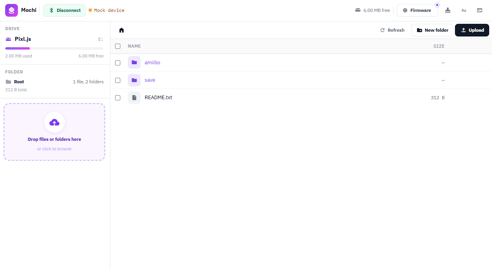

# Mochi

A browser-based tool to manage files and update firmware on [Pixl.js](https://github.com/solosky/pixl.js)-based NFC devices over Bluetooth. No app, no drivers, nothing extra.

**[Try it](https://mochi-nfc.cc/)** (requires Chrome, Edge, or Brave).



## File management

Connect your device and manage its storage directly from the browser:

- **File browser**: navigate folders, download, rename, delete and multi-select files
- **Search**: find files anywhere on the drive by name, or by the character on the tag
- **Uploader**: drop a local folder or files to upload, with live progress
- **Sync**: compare a local folder with the device, upload what's new or changed, and clean up files that only exist on the device
- **System file protection**: warns before you delete or rename files the firmware depends on (tag database, link mode slots, keys, settings). Sync and Normalize leave them alone
- **Normalize**: lowercase file and folder names for firmware compatibility
- **Format**: wipe and reformat the device drive
- **NFC tag lookup**: `.bin` files show character name and series from [AmiiboAPI](https://amiiboapi.org/)

Renaming a folder can take a few minutes on stock firmware (deleting one takes seconds): the device handles every file inside it one at a time and doesn't respond until it's done. Mochi asks first and waits it out, so keep the device on until it finishes. Deleting a folder deletes everything in it.

## Firmware update

Flash firmware directly over Bluetooth using Nordic Secure DFU. No extra tools required.

- **Auto-detect device mode**: connects to devices in normal or update mode from a single flow
- **Connected shortcut**: devices already paired from the file browser reboot into update mode automatically, no extra pairing needed
- **Model picker**: pick LCD or OLED and Mochi downloads the latest official release, or use your own `.zip`
- **Live progress**: real-time transfer speed, progress bar, and stage-by-stage status
- **Resilient transfers**: packet receipt notifications, CRC verification, and automatic retry on failure
- **Update notifications**: badge when a newer firmware version is available

Compatible with [Pixl.js](https://github.com/solosky/pixl.js)-based devices (allmiibo, amiibotool, Wuzplay, Flashiibo, and others).

## Development

To run the app locally:

```bash
# Generate a self-signed cert (one-time)
mkdir -p .cert
openssl req -x509 -newkey rsa:2048 -keyout .cert/key.pem -out .cert/cert.pem \
  -days 365 -nodes -subj "/CN=localhost"

# Start the dev server (HTTPS at localhost:8443)
python3 server.py --cert .cert/cert.pem --key .cert/key.pem
```

> Click **Mock device** in the top bar to try the app without hardware. It only shows up in local dev mode, on desktop widths.

## License

MIT. See [LICENSE](LICENSE).

## Libraries

- [JSZip](https://stuk.github.io/jszip/) for reading firmware `.zip` packages in the browser
- [Material Symbols](https://fonts.google.com/icons) for iconography
- [IBM Plex Mono](https://fonts.google.com/specimen/IBM+Plex+Mono) for monospace typography

## Thanks

- [solosky/pixl.js](https://github.com/solosky/pixl.js) for the open-source firmware that makes all of this possible
- [thegecko/web-bluetooth-dfu](https://github.com/thegecko/web-bluetooth-dfu) for the original Web Bluetooth Nordic Secure DFU implementation that served as the foundation for the firmware update module
- [Nordic Semiconductor](https://www.nordicsemi.com/) for the Secure DFU protocol specification and [reference implementations](https://github.com/NordicSemiconductor/pc-nrfutil)
- [AmiiboAPI](https://amiiboapi.org/) for the NFC tag character database
